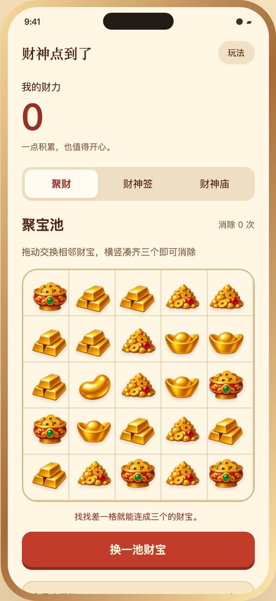
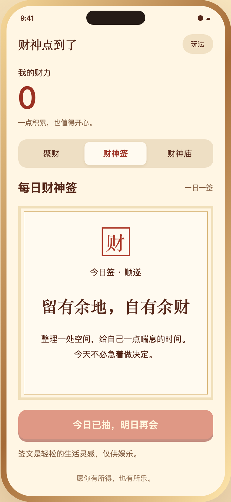

# GodOfWealthPointingAtYou
财神点你了

手机壳展示的本地网页原型「你被财神点到了」。

## 在线体验

[打开财神 App](https://jdb156158.github.io/GodOfWealthPointingAtYou/)

## 效果预览

| 聚财三消 | 每日财神签 | 财神庙（四阶） |
| --- | --- | --- |
|  |  |  |

## 本地运行

在仓库目录执行：

```sh
python3 -m http.server 5173 --bind 127.0.0.1
```

打开 http://127.0.0.1:5173/app.html 。

## 当前功能

- 财宝三消：拖动交换相邻财宝，横竖三个及以上消除，支持掉落补齐、连消加分和无效交换退回。
- 每日财神签：每日一次抽签及生活灵感解读。
- 每日任务：完成消除目标后领取财力奖励。
- 财神庙：四阶建筑外观，使用财力升级，四级满级。
- 当前浏览器本地存档。

## 文件

- `app.html`、`app.css`、`app.js`：页面、样式和玩法逻辑。
- `treasures-v2.png`、`temples-v2.png`：财宝及四阶建筑素材。
- `index.html`：入口，跳转到游戏页面。
- `财神方向对比.html`、`财神方向对比.png`：最初的三个设计方向。
- `directions.md`、`direction-approved.md`：方向说明及 A 方向选择记录。

静态页面无需构建或后端。GitHub Pages 从 `main` 分支根目录发布，后续推送自动更新。
